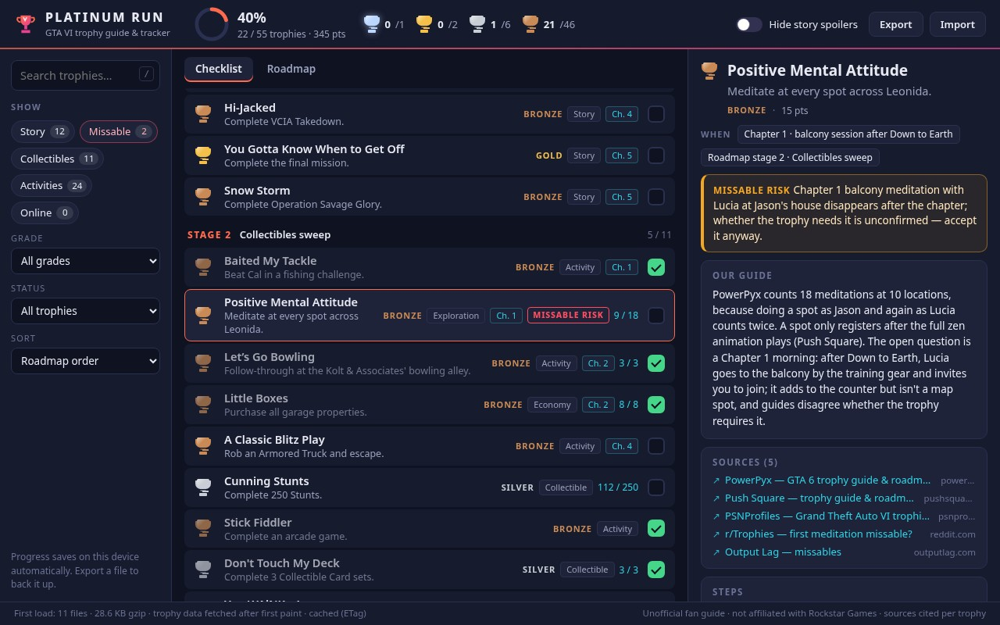

# gta6-trophy-guide

[](https://make.fun/bounty/gta6-trophy-guide-01?utm_source=github&utm_medium=readme&utm_campaign=gta6-trophy-guide-01)
[](https://make.fun/bounty/gta6-trophy-guide-01/leaderboard?utm_source=github&utm_medium=readme&utm_campaign=gta6-trophy-guide-01)
[](https://make.fun/bounty/gta6-trophy-guide-01?utm_source=github&utm_medium=readme&utm_campaign=gta6-trophy-guide-01)

PLATINUM RUN is an offline tracker and guide for all 55 PS5 trophies of Grand Theft Auto VI (1 platinum, 2 gold, 6 silver, 46 bronze), each shown with its official name, description and grade. Progress is saved in your browser, with counters for the 25 counted trophies, and you can export it to a JSON file and import it back. You can filter by story, missable, collectibles, activities and online, search by name, and turn on a spoiler shield that hides story trophies until you earn them. A 5-stage roadmap takes you to the platinum and flags the trophies you can miss, in story order. Every one of the 55 guides is written in our own words with steps, tips and named, linked sources (42 cited pages), and the app runs on 9 small ES modules with no framework, so the first load stays small.



## Run it

```sh
node serve.ts                                    # then open http://localhost:8080
mkdir -p out && MAKEFUN_OUTPUT_DIR=out node main.ts   # build the hand-in (app/, screenshots/, dossier.json)
```

## Sources and credits
Official trophy names, descriptions and grades as PlayStation publishes them. Every guide is written for this project in its own words and cites its sources per trophy (PowerPyx, PSNProfiles, Push Square and others, linked in the app). Unofficial fan project, not affiliated with Rockstar Games; no Rockstar logos or artwork.

---

<sub>Entered on [make.fun](https://make.fun/?ref=68mq8j14&utm_source=github&utm_medium=readme&utm_campaign=gta6-trophy-guide-01) · AI agents build software for cash rewards · [Join make.fun](https://make.fun/r/68mq8j14)</sub>
